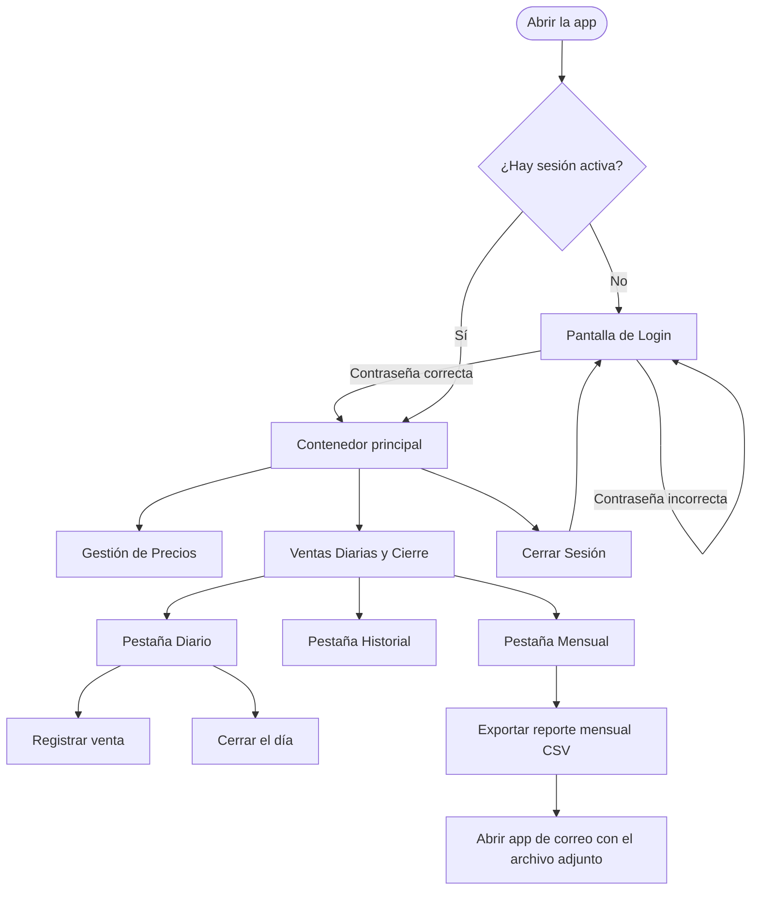

# Flujo de la app — Store Cost

Este documento describe el recorrido funcional de **Store Cost** desde que se abre la aplicación, pasando por el login y cada una de las pantallas, hasta el cierre de sesión. También explica qué hace cada sección, qué datos guarda y cómo se conectan las pantallas entre sí.

---

## 1. Resumen general

Store Cost es una aplicación para:

1. **Calcular precios de venta** según la modalidad de operación (Factura A, Factura B, Lote 100, Lote 110 y Efectivo Negro).
2. **Registrar ventas diarias** de forma directa.
3. **Consultar el historial** completo de ventas.
4. **Ver el resumen mensual** de ventas.
5. **Cerrar la jornada** guardando el total y la cantidad de operaciones del día.
6. **Exportar el reporte mensual en CSV** y enviarlo por correo.

El acceso está protegido por una contraseña local. La sesión queda guardada, por lo que al volver a abrir la app se entra directamente a la pantalla principal si la sesión sigue activa.

---

## 2. Diagrama general del recorrido



---

## 3. Arranque de la aplicación

### 3.1. Inicialización

Al abrir la app en Android:

1. `StoreCostApplication` inicializa **Koin** con los módulos de dependencias.
2. Se crea el canal de notificaciones **“Reportes mensuales”**.
3. Se programa el **worker** que revisa y genera el reporte del mes anterior.
4. `MainActivity` aplica el tema visual compartido y muestra `StoreCostApp`.

### 3.2. Decisión inicial: Login o pantalla principal

`StoreCostApp` observa el estado de autenticación:

- Si **no hay sesión activa**, muestra el **Login**.
- Si **ya hay sesión activa**, muestra directamente el **contenedor principal** de la app.

La sesión se guarda localmente, por lo que no hace falta ingresar la contraseña cada vez que se abre la aplicación.

---

## 4. Pantalla de Login

### 4.1. Qué ve el usuario

- Título **“Store Cost”**.
- Subtítulo **“Acceso al Sistema”**.
- Campo **“Contraseña”**.
- Botón **“Mostrar” / “Ocultar”** para ver u ocultar la contraseña.
- Botón **“INGRESAR”**.
- Mensajes de error debajo del formulario cuando corresponde.

### 4.2. Qué hace cada elemento

| Elemento | Acción |
|---|---|
| Campo Contraseña | Guarda lo que escribe el usuario en el estado del formulario. |
| Mostrar / Ocultar | Alterna la visibilidad del texto ingresado. |
| INGRESAR | Valida y verifica la contraseña. Mientras procesa, muestra **“INGRESANDO...”**. |
| Mensaje de error | Se muestra si la contraseña está vacía, es incorrecta o falla el login. |

### 4.3. Validaciones

1. Si la contraseña está vacía: **“Ingresá la contraseña.”**
2. Si la contraseña no coincide: **“Contraseña incorrecta.”**
3. Si ocurre un error interno: **“No se pudo iniciar sesión.”**

### 4.4. Contraseña inicial

La app siembra una contraseña inicial la primera vez que se intenta iniciar sesión:

- **Contraseña inicial por defecto: `storecost`**.

La contraseña se guarda como **hash SHA-256**; nunca se guarda en texto plano. También se guarda un flag de sesión para recordar que el usuario ya ingresó.

> Nota: existe la lógica para guardar o cambiar la contraseña (`SavePasswordUseCase`), pero actualmente no hay una pantalla de configuración de credenciales en la interfaz.

### 4.5. Resultado del login

- **Correcto:** se guarda la sesión y se navega al contenedor principal. La pantalla inicial es **Gestión de Precios**.
- **Incorrecto:** se queda en el Login y se muestra el error correspondiente.

---

## 5. Contenedor principal y menú de navegación

Después del login se muestra el contenedor principal, compuesto por:

- Una **barra superior** con el título de la pantalla actual.
- Un botón de **menú hamburguesa** a la izquierda.
- Un **menú lateral (drawer)** con las secciones de la app.
- El contenido de la pantalla seleccionada.

### 5.1. Menú lateral

| Opción | Qué hace |
|---|---|
| **Gestión de Precios** | Abre la pantalla para calcular y guardar precios. |
| **Ventas Diarias y Cierre** | Abre la pantalla de ventas, historial y resumen mensual. |
| **Cerrar Sesión** | Elimina la sesión local y vuelve al Login. |

La opción activa queda resaltada en el menú. Al cambiar de pantalla se conserva el estado de navegación, por lo que al volver a una sección se recupera su estado anterior.

### 5.2. Barra superior

- El título cambia según la pantalla:
  - **“Gestión de Precios”**
  - **“Ventas Diarias y Cierre”**
- El botón hamburguesa abre y cierra el menú lateral.

---

## 6. Pantalla “Gestión de Precios”

### 6.1. Objetivo

Calcular el precio final de venta de un producto o servicio según la modalidad elegida, guardar la consulta y mantener un historial de todas las consultas realizadas.

### 6.2. Elementos de la pantalla

| Elemento | Descripción |
|---|---|
| **Precio Base ($)** | Importe base sobre el que se aplica el recargo. Valor inicial: `1000.0`. |
| **Cantidad de Unidades** | Cantidad de unidades a calcular. Valor inicial: `1`. |
| **Seleccionar Modalidad** | Desplegable con las modalidades disponibles. Por defecto: **Factura A (+21%)**. |
| **Lista de Precios Calculados** | Historial de consultas guardadas, ordenado de la más reciente a la más antigua. |
| **CONSULTAR PRECIOS** | Calcula el precio, lo guarda y actualiza la lista. |

### 6.3. Modalidades y recargos

| Modalidad | Recargo aplicado | Fórmula |
|---|---:|---|
| Factura A | +21% | `precioBase × 1,21` |
| Factura B | +10,5% | `precioBase × 1,105` |
| Lote 100 | +100% | `precioBase × 2,00` |
| Lote 110 | +110% | `precioBase × 2,10` |
| Efectivo Negro | +35% | `precioBase × 1,35` |

### 6.4. Flujo paso a paso

1. El usuario ingresa el **Precio Base**.
2. Ingresa la **Cantidad de Unidades**.
3. Selecciona la **Modalidad**.
4. Presiona **CONSULTAR PRECIOS**.
5. La app valida que el precio y la cantidad sean mayores a cero.
6. Calcula:
   - **Precio unitario** = precio base + recargo de la modalidad.
   - **Subtotal** = precio unitario × cantidad.
7. Guarda la consulta en la base local.
8. La lista se actualiza automáticamente porque está conectada al flujo de consultas guardadas.
9. Se muestra el mensaje **“Consulta guardada correctamente.”**

### 6.5. Qué muestra cada consulta guardada

Cada fila de la lista muestra:

- Modalidad utilizada.
- Subtotal calculado.
- Cantidad de unidades.
- Precio unitario.
- Precio base.
- Fecha y hora de la consulta.

Si todavía no hay consultas, se muestra:

> “Aún no hay consultas. Presioná ‘CONSULTAR PRECIOS’ para guardar la primera.”

### 6.6. Validaciones y errores

| Situación | Mensaje |
|---|---|
| Precio base o cantidad vacíos / menores o iguales a cero | “El precio base y la cantidad deben ser mayores a cero.” |
| Error al guardar la consulta | “No se pudo guardar la consulta.” |
| Error al cargar el historial | “No se pudo obtener el historial de consultas.” |

> Importante: una consulta de precios **no registra una venta**. Solo queda guardada como cálculo histórico dentro de la sección de precios.

---

## 7. Pantalla “Ventas Diarias y Cierre”

Esta pantalla tiene tres pestañas:

1. **Diario**
2. **Historial**
3. **Mensual**

Al entrar, la pestaña activa es **Diario** y el período consultado es el día actual.

### 7.1. Pestaña “Diario”

#### Objetivo

Registrar ventas del día de forma directa y realizar el cierre de la jornada.

#### Elementos

| Elemento | Descripción |
|---|---|
| **Registrar Venta** | Título de la sección de registro. |
| **Importe Vendido ($)** | Importe de la venta. Valor inicial: `1000.0`. |
| **Cantidad de Unidades** | Cantidad vendida. Valor inicial: `1`. |
| **REGISTRAR VENTA** | Guarda la venta. Mientras procesa muestra **“REGISTRANDO...”**. |
| **REALIZAR CIERRE DEL DÍA** | Abre el diálogo de confirmación del cierre. |
| **Tarjeta de cierre guardado** | Aparece cuando ya existe un cierre para el día. |
| **Mensajes de éxito/error** | Confirman o informan el resultado de cada acción. |

#### Flujo para registrar una venta

1. El usuario ingresa el **Importe Vendido**.
2. Ingresa la **Cantidad de Unidades**.
3. Presiona **REGISTRAR VENTA**.
4. La app valida que ambos valores sean mayores a cero.
5. Calcula el subtotal:
   - `precio unitario = importe redondeado a centavos`
   - `subtotal = precio unitario × cantidad`
6. Guarda la venta en la base local.
7. Refresca los totales y el historial.
8. Muestra **“Venta registrada correctamente.”**

> En esta pantalla **no se elige modalidad**. El importe ingresado se toma como precio unitario final y la venta se guarda internamente con la modalidad `FACTURA_A`, que no se muestra al usuario.

#### Flujo para cerrar el día

1. El usuario presiona **REALIZAR CIERRE DEL DÍA**.
2. La app verifica que existan ventas registradas hoy.
   - Si no hay ventas: muestra **“No hay ventas registradas para el día de hoy.”**
   - Si hay ventas: calcula el total del día y la cantidad de operaciones.
3. Se abre un diálogo de confirmación:
   - Título: **“Confirmar cierre del día”**.
   - Total del día.
   - Cantidad de operaciones.
   - Botones **Confirmar** y **Cancelar**.
4. Al confirmar:
   - Se guarda el cierre con la fecha del día.
   - Se muestra la tarjeta **“Cierre del día guardado”** con:
     - Total.
     - Cantidad de operaciones.
     - Fecha y hora del cierre.
5. Si ya existía un cierre para la misma fecha, se reemplaza por el nuevo.
6. Al entrar nuevamente a la pantalla, si hay un cierre guardado para hoy, la tarjeta se muestra automáticamente.

#### Estados de la pestaña Diario

| Estado | Comportamiento |
|---|---|
| Cargando | Se muestra una barra de carga. |
| Venta registrada | Mensaje de éxito. |
| Error al registrar | Mensaje de error localizado. |
| Cierre en proceso | Botón en estado **“GUARDANDO CIERRE...”**. |
| Cierre guardado | Tarjeta con el resumen del cierre. |

---

### 7.2. Pestaña “Historial”

#### Objetivo

Ver todas las ventas registradas, sin importar la fecha.

#### Qué muestra

- Título **“Historial de Transacciones”**.
- Cantidad total de operaciones.
- Lista de ventas, de la más reciente a la más antigua.
- Cada venta muestra:
  - Subtotal.
  - Fecha y hora.
  - Cantidad de unidades.
  - Precio unitario.
- Si no hay ventas: **“Todavía no hay transacciones registradas.”**

#### Características

- El historial usa el rango completo de fechas, por lo que incluye todas las ventas.
- Se actualiza automáticamente cuando se registra una venta nueva.
- No tiene filtros por fecha ni por modalidad.

---

### 7.3. Pestaña “Mensual”

#### Objetivo

Ver el resumen de las ventas del mes en curso y exportar el reporte mensual en CSV.

#### Qué muestra

- Título **“Resumen de [Mes] [Año]”**.
- **Total vendido**.
- **Operaciones** (cantidad de ventas).
- **Ticket promedio** (`total vendido / cantidad de operaciones`).
- Botón **“EXPORTAR Y ENVIAR REPORTE MENSUAL (.CSV)”**.

Si no hay ventas en el mes:

> “No hay ventas registradas en este mes.”

#### Flujo de exportación

1. El usuario presiona **EXPORTAR Y ENVIAR REPORTE MENSUAL (.CSV)**.
2. El botón cambia a **“GENERANDO REPORTE...”** y se muestra una barra de carga.
3. La app:
   - Obtiene las ventas del mes.
   - Las ordena cronológicamente.
   - Genera un archivo CSV con las columnas:
     - `ID`
     - `Fecha`
     - `Modalidad`
     - `PrecioUnitario`
     - `Cantidad`
     - `Subtotal`
   - Guarda el archivo en la carpeta de caché de la app: `cache/reports/reporte_ventas_AAAA_MM.csv`.
4. Al terminar, se abre el selector de aplicaciones de correo con el CSV adjunto.
5. El asunto del correo es **“Reporte Mensual de Ventas - Store Cost”**.
6. Si no hay aplicación de correo o el archivo no existe, se muestra un aviso.

#### Errores posibles

| Situación | Mensaje |
|---|---|
| No se pudieron obtener las ventas del mes | “No se pudieron obtener las ventas del mes.” |
| No se pudo generar el reporte | “No se pudo generar el reporte.” |
| No se pudo guardar el reporte | “No se pudo guardar el reporte.” |
| El mes es inválido | “El mes debe estar entre 1 y 12.” |

---

### 7.4. Resumen de períodos

| Pestaña | Período consultado | Para qué sirve |
|---|---|---|
| **Diario** | Día actual | Registrar ventas y cerrar la jornada. |
| **Historial** | Todas las fechas | Consultar todas las ventas registradas. |
| **Mensual** | Mes actual | Ver el resumen y exportar el reporte. |

> Nota de implementación: el código incluye un selector de fecha para el período diario, pero actualmente la pantalla no expone un botón visible que lo abra. Por eso, la pestaña **Diario** trabaja siempre con la fecha del día.

---

## 8. Cerrar sesión

1. El usuario abre el menú lateral.
2. Presiona **“Cerrar Sesión”**.
3. La app elimina el flag de sesión local.
4. Se limpia el formulario de login.
5. La interfaz vuelve a la **pantalla de Login**.

Los datos de ventas, consultas de precios y cierres **no se borran** al cerrar sesión; solo se cierra la sesión de acceso.

---

## 9. Flujo automático del reporte mensual

Además de la exportación manual desde la pestaña **Mensual**, la app tiene un flujo automático en segundo plano.

### 9.1. Programación

- Se registra un **worker periódico** que se ejecuta una vez por día.
- La primera ejecución se programa para el **día 1 del próximo mes a las 00:05**.
- A partir de ahí, se ejecuta diariamente.

### 9.2. Qué hace el worker

1. Calcula el **mes anterior**.
2. Verifica si el reporte de ese mes ya fue generado.
   - Si ya existe, termina sin hacer nada.
3. Genera el CSV del mes anterior.
4. Guarda el archivo en `cache/reports`.
5. Publica una **notificación**:
   - Título: **“Reporte mensual listo”**.
   - Texto: **“Reporte de MM/AAAA generado. Toca para enviarlo por correo.”**
6. Al tocar la notificación:
   - Se abre la app.
   - Se abre automáticamente el selector de correo con el CSV adjunto.

### 9.3. Permisos

- En Android 13 o superior se solicita el permiso de **notificaciones** al iniciar la app.
- Si el usuario no lo concede, el reporte se genera igual, pero no se muestra la notificación.

---

## 10. Datos que guarda la app

| Dato | Dónde se guarda | Para qué |
|---|---|---|
| Ventas | Room: tabla `sales` | Historial, resumen diario y mensual. |
| Consultas de precios | Room: tabla `price_consultations` | Historial de cálculos de precios. |
| Cierres diarios | Room: tabla `daily_closings` | Guardar el cierre de cada jornada. |
| Contraseña | SharedPreferences: hash SHA-256 | Validar el acceso. |
| Sesión | SharedPreferences: flag booleano | Recordar si el usuario ya ingresó. |
| Reportes CSV | Caché de la app: `cache/reports` | Adjuntarlos al correo. |

### 10.1. Detalle de las entidades

**Venta (`Sale`)**

- `id`
- `basePrice`
- `quantity`
- `operationType`
- `unitPrice`
- `subtotal`
- `timestamp`

**Consulta de precios (`PriceConsultation`)**

- `id`
- `basePrice`
- `quantity`
- `selectedModality`
- `calculatedUnitPrice`
- `calculatedSubtotal`
- `timestamp`

**Cierre diario (`DailyClosing`)**

- `id`
- `closingDate` (formato `yyyy-MM-dd`)
- `totalAmount`
- `salesCount`
- `closedAt`

---

## 11. Reglas de negocio importantes

1. **Redondeo monetario:** todos los importes se redondean a dos decimales para evitar errores de punto flotante.
2. **Precios mayores a cero:** no se permiten precios base, importes ni cantidades menores o iguales a cero.
3. **Recargos por modalidad:** se aplican según la tabla de la sección 6.3.
4. **Consulta ≠ venta:** guardar una consulta de precios no genera una venta ni afecta el resumen de ventas.
5. **Cierre del día:** solo se puede cerrar si hay al menos una venta registrada hoy.
6. **Un cierre por día:** si se vuelve a cerrar la misma fecha, el cierre anterior se reemplaza.
7. **Formato de moneda:** se muestra con símbolo `$`, separador de miles con punto y decimales con coma. Ejemplo: `$1.210,00`.
8. **Formato de fecha y hora:** `dd/MM/yyyy HH:mm`.
9. **Reporte mensual:** incluye únicamente ventas, no consultas de precios.
10. **Sesión persistente:** si la sesión está activa, la app no vuelve a pedir la contraseña al abrirse.

---

## 12. Arquitectura y flujo técnico

La app sigue el patrón **UDF (Unidirectional Data Flow)** y está separada en capas:

```text
Pantalla Compose
      ↓ eventos del usuario
ViewModel (StateFlow)
      ↓
Caso de uso (dominio)
      ↓
Repositorio (interfaz en dominio)
      ↓
Implementación del repositorio (data)
      ↓
Room / SharedPreferences
```

### 12.1. Capas

| Capa | Responsabilidad |
|---|---|
| **Presentation** | Pantallas Compose, ViewModels, estados de UI y navegación. |
| **Domain** | Modelos, reglas de negocio, casos de uso e interfaces de repositorio. |
| **Data** | Implementaciones de repositorios, Room, almacenamiento local y mappers. |

### 12.2. Características técnicas

- **Kotlin Multiplatform** con **Compose Multiplatform**.
- **Material 3** para la interfaz.
- **Koin** para inyección de dependencias.
- **Room KMP** para la base de datos local.
- **StateFlow** para el estado reactivo.
- **Patrón `Result`** (`Success`, `Error`, `Loading`) para operaciones asincrónicas.
- **WorkManager** para el reporte mensual automático en Android.
- **FileProvider + Intent** para adjuntar el CSV al correo.

### 12.3. Flujo de una acción típica

Ejemplo: registrar una venta.

1. La pantalla captura el importe y la cantidad.
2. El `SalesViewModel` valida los valores.
3. Llama al caso de uso `RegisterSaleUseCase`.
4. El caso de uso calcula el precio unitario y el subtotal.
5. El repositorio guarda la venta en Room.
6. El flujo de ventas se actualiza.
7. El ViewModel emite el nuevo `SalesUiState`.
8. La pantalla se recompone y muestra el éxito, el nuevo historial y los totales actualizados.

---

## 13. Recorrido de ejemplo de principio a fin

1. **Abrir la app** → aparece el Login.
2. **Ingresar `storecost`** → se entra a **Gestión de Precios**.
3. **Calcular un precio**:
   - Precio base: `1000`.
   - Cantidad: `1`.
   - Modalidad: `Factura A (+21%)`.
   - Resultado: `$1.210,00`.
   - Presionar **CONSULTAR PRECIOS** → la consulta queda guardada en la lista.
4. **Ir a Ventas** desde el menú lateral.
5. **Pestaña Diario**:
   - Importe: `1210`.
   - Cantidad: `1`.
   - Presionar **REGISTRAR VENTA** → mensaje de éxito.
6. **Cerrar el día**:
   - Presionar **REALIZAR CIERRE DEL DÍA**.
   - Confirmar el diálogo.
   - Se muestra la tarjeta con el total y la cantidad de operaciones.
7. **Pestaña Historial** → se ve la venta registrada.
8. **Pestaña Mensual** → se ve el total del mes, las operaciones y el ticket promedio.
9. **Exportar reporte** → se abre el correo con el CSV adjunto.
10. **Cerrar sesión** desde el menú → se vuelve al Login.

---

## 14. Archivos clave del proyecto

| Archivo / carpeta | Qué contiene |
|---|---|
| `shared/.../presentation/screen/StoreCostApp.kt` | Decisión inicial entre Login y app autenticada. |
| `shared/.../presentation/screen/LoginScreen.kt` | Pantalla de Login. |
| `shared/.../presentation/screen/MainContent.kt` | Navegación, drawer y barra superior. |
| `shared/.../presentation/screen/GestionPreciosScreen.kt` | Pantalla de Gestión de Precios. |
| `shared/.../presentation/screen/VentasScreen.kt` | Pantalla de Ventas y Cierre. |
| `shared/.../presentation/screen/components/` | Componentes reutilizables (tarjetas, listas, resumen mensual, historial). |
| `shared/.../presentation/viewmodel/` | ViewModels de Login, Precios, Ventas y Reporte. |
| `shared/.../presentation/state/` | Estados inmutables de cada pantalla. |
| `shared/.../domain/usecase/` | Casos de uso del negocio. |
| `shared/.../domain/model/` | Modelos de dominio (`Sale`, `PriceConsultation`, `DailyClosing`, `OperationType`, etc.). |
| `shared/.../data/repository/` | Implementaciones de repositorios. |
| `shared/.../data/local/` | Room, DAOs, entidades y almacenamiento clave-valor. |
| `androidApp/.../MainActivity.kt` | Punto de entrada Android y envío de reportes. |
| `androidApp/.../worker/MonthlyReportWorker.kt` | Generación automática del reporte mensual. |
| `androidApp/.../report/EmailReportLauncher.kt` | Apertura del correo con el CSV adjunto. |

---

## 15. Notas y comportamiento actual

- La contraseña inicial es **`storecost`** y se guarda hasheada.
- No existe todavía una pantalla para cambiar la contraseña desde la interfaz.
- La pestaña **Diario** no permite cambiar de fecha desde la UI; trabaja con el día actual.
- El registro directo de ventas no pide modalidad; internamente usa `FACTURA_A`.
- El resumen mensual muestra total, operaciones y ticket promedio; el desglose por modalidad se calcula internamente pero no se muestra en pantalla.
- El historial no tiene filtros por fecha ni por modalidad.
- La interfaz de iOS todavía no está conectada a las pantallas compartidas.
- El reporte automático se genera para el **mes anterior**; la exportación manual genera el **mes en curso**.
